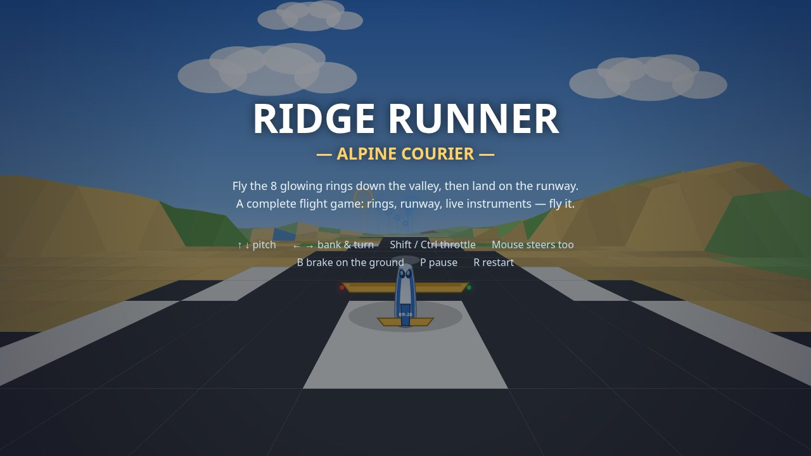
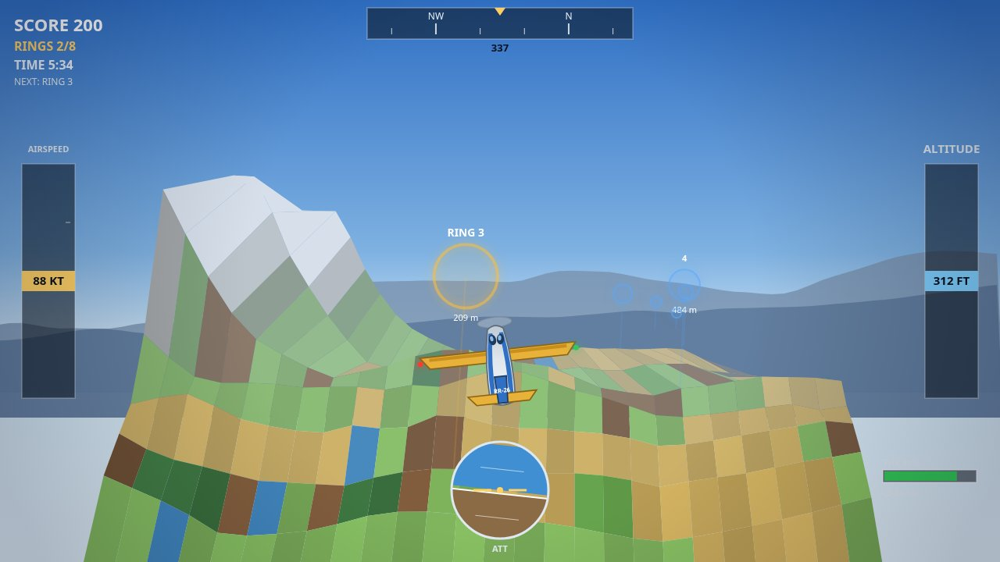
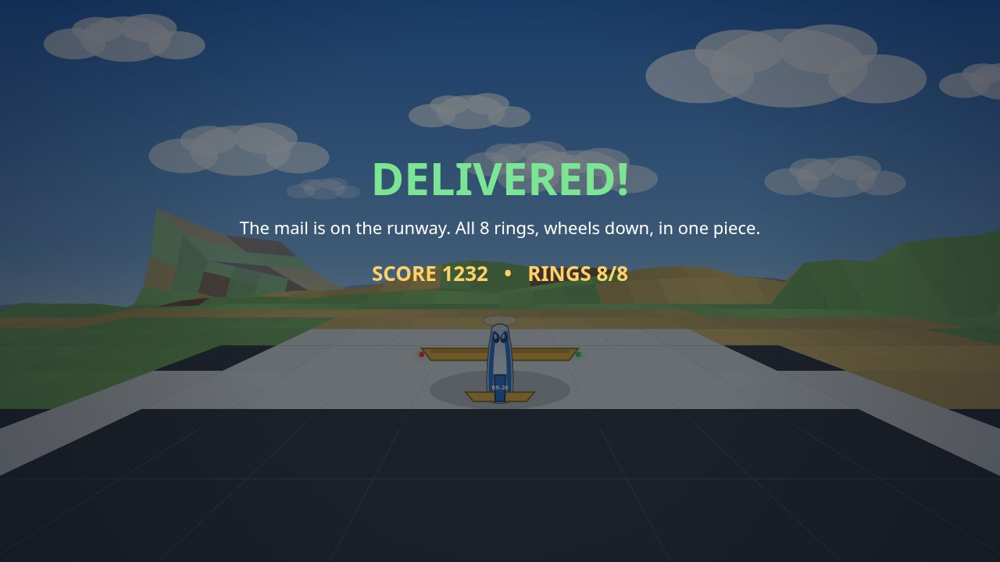

# Ridge Runner — Alpine Courier

A bush-plane courier run through a mountain valley. Take off from a grass
airstrip, thread eight glowing rings up the valley, then turn around and put
her back down on the same strip — before the six-minute clock runs out.

## The job

The valley's only airstrip sits at the foot of a ridge line. Eight mail rings
hang over the river, weaving from side to side and climbing as the valley
rises. Fly through each one (+100 points), miss one and the next ring is all
that counts — there is no going back for it. After the eighth ring the runway
opens: fly the pattern, come down the centreline, and land heading south
(time bonus: +2 points per second left on the clock).

Crash into a ridge, stall, or run out of time, and the mail is late.

## How to fly

| Input | Action |
| --- | --- |
| `W` / `↑` and `S` / `↓` | Pitch up / down |
| `A` / `←` and `D` / `→` | Bank left / right (the plane turns with the bank) |
| `Shift` / `Ctrl` | Throttle up / down |
| Mouse | Steer gently: bank toward the cursor, pitch with its height |
| `B` | Brake on the ground |
| `P` or `Esc` | Pause |
| `R` | Restart after a crash or a landing |
| `Enter` | Start from the title screen |
| `M` | Mute the engine and wind |

The HUD carries an artificial horizon, airspeed and altitude tapes, a
compass, throttle, a timer, and the score. A `PULL UP` warning flashes when
the ground is close and the nose is down; `STALL` warns when the speed falls
toward the edge of the envelope.

## What is in the box

- `game/index.html` — the page; everything else is plain ES modules.
- `game/src/world.js` — the flight model (takeoff, turning, stall, landing),
  the course, the ring logic, and a built-in autopilot that can fly the whole
  route on its own.
- `game/src/render.js` — the Canvas 2D view: perspective terrain, river,
  clouds, rings, the plane, and the full HUD.
- `game/src/config.js` — the plane, the valley, the course, and the clock.
- `game/src/random.js` — seeded noise, so the valley is the same every run.
- `game/src/audio.js` — procedural WebAudio: engine, wind, ring chimes.
- `game/src/input.js` — keyboard and mouse.
- `game/src/shots.js` — the staged scenes behind `?shot=start|play|end`.
- `game/src/main.js` — the game loop.
- `main.ts` — the hand-in program: copies `game/` and `screenshots/` to the
  output directory and writes `dossier.json`.
- `serve.ts` — a tiny static server for playing locally (`node serve.ts`,
  then open <http://localhost:8080>).

No dependencies, no build step, no network calls: open the page and fly.

## How it was tested

The flight model runs headless in Node, steered by the built-in autopilot,
from the same `world.js` the browser loads. The autopilot takes off, flies
all eight rings, and lands on the runway in 143.6 seconds for 1,232 points
(800 for the rings, 432 time bonus) — verified three times, identical every
time, because the world is seeded. The screenshots are the real game staged
through `?shot=start|play|end`, not mock-ups: the play frame is the autopilot
26 seconds into the course, the end frame is the actual landing.

## License

MIT — see [LICENSE](LICENSE).
